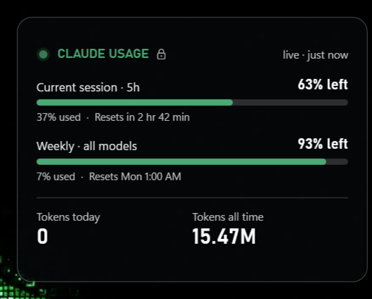

# Claude Usage Widget

A small translucent Windows desktop widget that shows your Claude plan limits and token usage.



## Features

- **5-hour session** and **weekly** limits: percent left, percent used and reset time
- **Tokens today** and **all time**, counted from local Claude Code / Cowork session logs (hover for a breakdown)
- Pinned to the desktop: survives Win+D, never shows in the taskbar
- Draggable and resizable, with a **Lock position & size** option
- Starts with Windows
- **No model calls:** refreshing costs 0 tokens

## Build & run

There are no dependencies: it compiles with the C# compiler that ships with Windows (.NET Framework 4.x).

```bat
build.cmd
```

This installs the widget to `%LOCALAPPDATA%\ClaudeUsageWidget\ClaudeUsageWidget.exe` and starts it. It also adds itself to startup on the first run.

## Live limits

Right-click the widget and choose **Sign in for live limits…**. This runs `claude auth login` once. After that, the widget reads Claude Code's credentials and polls the usage endpoint every 2 minutes.

Without signing in, it falls back to the snapshot file the Claude desktop app writes (`%APPDATA%\Claude\plan-usage-history.json`). That snapshot may be out of date.

## Right-click menu

Lock position & size · Refresh now · Background tint · Reset size · Start with Windows · Exit.
A tray icon offers the same basics.

Logs are written to `%LOCALAPPDATA%\ClaudeUsageWidget\widget.log`.

> Unofficial; not affiliated with Anthropic.
